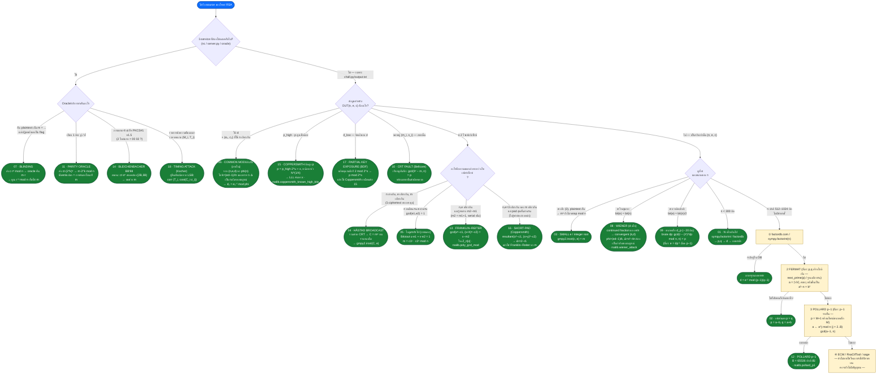

# RSA — แผนผังจำแนกรูปแบบโจทย์

>  **วิธีใช้:** รับแหล่งข้อมูล RSA → อ่านไดอะแกรม **จากโหนดบนลงล่าง** ตอบคำถามทีละข้อ (ภาพเพชร) ใบเขียว = สรุปรูปแบบปัญหา+สูตรแก้ ชุดรูปแบบมาตรฐาน 18 รูปแบบอยู่ที่ `rsa/challenge/` (ตัวอย่างโซลูชัน `rsa/solves/`, ไลบรารี `rsa/challenge/_lib/rsalib.py`, ทฤษฎี: `rsa/RSA-survey-vi.md`)

## แผนภาพการตัดสินใจ (จากบนลงล่างตามลำดับ)

## การติดตามย้อนกลับ: สัญญาณในแหล่งที่มา/เอาต์พุต → รูปแบบ

หากต้องการรับแหล่งที่มา ให้ grep/detect ตัวอย่างเหล่านี้ก่อน - ส่งออกบทความทันที:

| คุณเห็นอะไรใน chall | รูปแบบ | บทความ |
|---|---|---|
| `getPrime(48)`, n < 300 บิต | N เล็กเกินไป → ตัวประกอบโดยตรง | 01 |
| `next_prime(p)`, `gen_prime_near`, q ถูกสร้างขึ้นจากฐานเดียวกัน | แฟร์มาต์ p ≈ q | 02 |
| `e = 3` ไม่มีแผ่นรอง แฟล็กสั้น `assert m**3 < n` | รูต อี จำนวนเต็ม | 03 |
| หลายบรรทัด `n1..ne` + `c1..ce` เหมือนกัน e | Håstadออกอากาศ | 04 |
| เหมือนกัน n สอง `e_b`, `e_c` coprime | โมดูลัสทั่วไปภายนอก | 05 |
| **ให้ `d`** (+ e₂, c₂ พร้อม n) | โมดูลัสทั่วไปใน → phi phi | 06 |
| เซิร์ฟเวอร์ถาม `Text to decrypt:` | คำพยากรณ์ที่มองไม่เห็น | 07 |
| `e.bit_length()` ≈ `n.bit_length()` (e ~ 1024 บิต) | Wiener d เล็ก | 08 |
| `e = pow(dp, -1, p-1)` — e ~ 512 บิต เมื่อ n 1,024 บิต | ตัวเล็ก d_p | 09 |
| บันทึกลายเซ็นหลายคู่ `m_i`, `s_i` | ข้อผิดพลาด CRT — gcd(ŝᵉ−m, n) | 10 |
| เซิร์ฟเวอร์ส่งคืน `Even` / `Odd` | พาริตีออราเคิล | 11 |
| `p = m + 1` พร้อม m = สะสมจำนวนเฉพาะขนาดเล็ก | พอลลาร์ด p−1 | 12 |
| 2 กะรัต, `M2 == M1 + 1` (อนุกรม/ยกขึ้นแบบนับ) | แฟรงคลิน–ไรเตอร์ | 13 |
| `block[0:2] == b"\x00\x02"`, PKCS#1 สอดคล้องกับ oracle | ไบลเชนบาเคอร์ | 14 |
| `p_high = p >> U` รวมอยู่ในเอาต์พุต | Coppersmith บิตสูง | 15 |
| `M = (msg << 32) \| r` ส่ง 2 ครั้งโดยมี r | ต่างกัน การโจมตีด้วยแผ่นสั้น | 16 |
| รวม `d_low = d % 2^s` | การเปิดเผยคีย์บางส่วน BDF | 17 |
| หลายพันบรรทัด `M_i T_i` (เวลา µs) | ไทม์มิ่งโจมตี Kocher | 18 |

รูปแบบ ## 18 — เงื่อนไขทางคณิตศาสตร์และคำสั่งแก้โจทย์

| # | รูปแบบ | เงื่อนไข | โซลูชัน (1 บรรทัด) | เครื่องมือ |
|---|---|---|---|---|
| 01 | N เล็กเกินไป | n < ~ 300 บิต | `sympy.factorint(n)` → ง | factordb/แฟคเตอร์ |
| 02 | แฟร์มาต์ | \|p−q\| เล็ก ใกล้ a² | a=⌈√n⌉ ค่อยๆ ขึ้น b²=a²−n | ~20 บรรทัดของหลาม |
| 03 | อีเล็ก | mry < n (แกะห่อ) | `gmpy2.iroot(c, e)` | gmpy2 |
| 04 | ฮาสตัด | m เดียวกัน, e ciphertext, n_i | ต่างกัน ซีอาร์ที → iroot(C, e) | มือ CRT/gmpy2 |
| 05 | CM ภายนอก | เหมือนกัน n, gcd(e1,e2)=1 | ประเภท: ม = c1ᵘ·c2ᵛ | xgcd (หมายเหตุลบ → ผกผัน) |
| 06 | CM ใน | รู้ (n,e,d) | k=(ed−1)//n++ → ไม่ใช่ทางการ (Δ) | หลามบริสุทธิ์ |
| 07 | ทำให้ไม่เห็น | oracle ถอดรหัสลบแฟล็ก | c·rᵉ → m·r → ·r⁻¹ | 1 แบบสอบถาม |
| 08 | เวียนเนอร์ | d < ⅓·N^¼ (e ใหญ่มาก) | ต่อเนื่อง e/n → (k,d) → phi | `rsalib.wiener_attack` |
| 09 | d_p เล็ก | d_p ~ 2²⁰ (e ~ n/2 บิต) | เดรัจฉาน dp, gcd(r−r^{e·dp}, n) | รวดเร็วทันใจ (rᵉ)^dp |
| 10 | ข้อผิดพลาด CRT | 1 mod ลายเซ็นผิด q | gcd(ŝᵉ − m, n) = หน้า | เรียกดูบันทึก |
| 11 | ความเท่าเทียมกัน | oracle คู่/คี่ | ct·(2^k)ᵉ, ครึ่งเรื่อง | ~log₂n สอบถาม |
| 12 | พอลลาร์ด p−1 | p−1 บี-สมูท | a←a^j, gcd(a−1,n) | `rsalib.pollard_p1` |
| 13 | แฟรงคลิน–ไรเตอร์ | m2 = m1 + h (h รู้) | gcd พหุนาม mod n | `rsalib.poly_gcd_mod` |
| 14 | ไบลเชนบาเคอร์ | oracle สอดคล้อง 00 02 | BB'98: สแกน s ตัดกันประมาณ | ~1.4M ข้อความค้นหาออฟไลน์ |
| 15 | ช่างทองแดงชั้นสูง | รู้ ≥ n/4 บิตสูงของ p | p_high·2^u + x → LLL | `coppersmith_known_high_bits` |
| 16 | แผ่นสั้น | m ± แผ่นสั้นเดียวกัน e=3 | ผลลัพธ์ → Δ → FR | `coppersmith_small_roots` + FR |
| 17 | BDF บิตต่ำ d | รู้ ≥ ⌈n/4⌉ บิตต่ำ d | ม็อดรูปสี่เหลี่ยม 2^s → p_low → 15 | `solve_quad_mod_2k` + ตำรวจ |
| 18 | เวลา | T_i ขึ้นอยู่กับการคูณ | corr(T, cost(C·z)) ทีละนิด d | numpy corr, 8192 ตัวอย่าง |

## เมื่อ (n, e, c) คือ "สะอาด" — สเกลการวิเคราะห์ N

ตามลำดับชั้นใน `tools.md` (factordb ก่อน, Fermat ทันที):

1. **factordb** (ผ่าน `factordb-python`) — n มีอยู่ใน DB แล้ว และจะดำเนินการทันที
2. **แฟร์มาต์** — p, q อยู่ใกล้กัน (ราคาถูก แค่วิ่ง 1-2 นาทีก่อนค่อยคิดใหม่)
3. **พอลลาร์ด p−1** — p−1 ราบรื่น; รวม **p+1 (Williams)** หากเสนอจำนวนเฉพาะพิเศษ
4. **ECM** (PARI `factorint` แฟล็ก 2 / sage `ecm`) — ตัวประกอบน้อยกว่า ~60 หลัก
5. **RsaCtfTool** (Win-WSL) — บันทึกการโจมตีทั่วไป
6. Still dead → **กลับไปอ่านแหล่งที่มาครั้งที่สอง**: หัวข้อ 18/18 มีสัญญาณในรูปแบบใดก็ได้ในสาขาด้านบนของแผนภาพ

## แยกแยะคู่ที่สับสนได้ง่าย

- **03 กับ 04**: เช่นเดียวกับ e=3 — มีเพียง 1 ไซเฟอร์เท็กซ์ m³ จะต้อง *เล็กกว่า* กว่า n ถึง iroot; หากมีไซเฟอร์เท็กซ์ e *ต่างกัน n* เพียงพอ ให้ CRT ก่อนแล้วจึง iroot
- **08 กับ 09**: e ทั้งคู่ "ยาวผิดปกติ" — **bit(e) ≈ bit(n)** → d มีขนาดเล็ก (Wiener); **bit(e) ≈ bit(n)/2** → d_p ขนาดเล็ก (e สร้างโดย p−1). Wiener ล้มเหลว แต่ e ยังคง ~ n บิต → d ถึง N^0.292: **Boneh–Durfee** (แก้ตัวอย่างใน `lattice/L11_boneh_durfee/`)
- **05 กับ 06**: โมดูลัสเดียวกัน — ไม่มี d → มีไซเฟอร์เท็กซ์สองตัว **มี d** →ปัจจัย N / การลดทอน แข็งแกร่งกว่ามาก
- **13 กับ 16**: 2 ไซเฟอร์เท็กซ์ของ n และ e เดียวกัน — รู้ *แน่นอน* ความสัมพันธ์ m2−m1 → Franklin–Reiter; m เดียวกัน แต่ *เฉพาะแผ่นสุ่มที่แตกต่างกัน* (ไม่ทราบความแตกต่าง) → แผ่นสั้น (ผลลัพธ์ก่อน FR ในภายหลัง)
- **15 vs 17**: ปลายทั้งสองด้านเป็น Coppersmith — รั่วที่ **p** (บิตสูง, shift ไปทางซ้าย `2^u`) เทียบกับรั่วที่ **d** (บิตต่ำ, โซลูชัน pt ลำดับที่ 2 `2^s` mod ย้ายการรั่วไหลไปที่ p ก่อน)
- **06 และสาขา "ข้อมูลเพิ่มเติม" ใดๆ**: จัดลำดับความสำคัญสาขาด้วยข้อมูลแปลก ๆ เสมอ (d, p_high, d_low, ลายเซ็นต์, หลาย cts) ก่อนที่จะประเมิน (n,e,c) — นั่นคือสาเหตุที่ Q2 อยู่เหนือ Q5 ในแผนภาพ
