# Symmetric Cipher — แผนผังจำแนกรูปแบบโจทย์

>  **วิธีใช้:** รับ chall แหล่งที่มาแบบสมมาตร (AES/DES/stream/oracle) → อ่านไดอะแกรม **จากโหนดบนลงล่าง** ตอบคำถามทีละข้อ (ภาพเพชร) ใบเขียว = สรุปรูปแบบปัญหา+สูตรแก้ ที่มา: Symmetric Ciphers 29 ตัวของ CryptoHack (cryptohack.org/challenges/aes) หมายเลข 01–29 ตามหมวดหมู่ เอกสารสรุปทางเทคนิคพร้อมรหัส: `cheatsheet-symmetric.md` แก้โมเดล: `Cryptohack/`

## แผนภาพการตัดสินใจ (จากบนลงล่างตามลำดับ)

```mermaid
flowchart TD
    START(["ได้รับ source ของโจทย์ SYMMETRIC"]):::start --> Q0{"โจทย์เป็นประเภทใด?"}

    Q0 -->|"บทเรียนเกี่ยวกับการนำ AES<br> ไปใช้ (เทมเพลตโค้ด ไม่มีบริการ <br> ไม่มีข้อมูลที่ซ่อนอยู่)"| GA(["จัดกลุ่มวิธีการทำงานของ AES 01–07<br>state 4x4 ↔ ไบต์ (03) · AddRoundKey = XOR (04)<br>inv S-box (05) · inv ShiftRows + inv MixColumns (06)<br>ถอดรหัสเต็ม 10 รอบ: XOR k10 จากนั้นทำซ้ำ 9→1<br>invShift → invSub → XOR → invMix (07)"]):::res
    Q0 -->|"การเข้ารหัสแบบ DIY อิงตาม AES<br> (การปรับแต่งที่ป้องกัน NSA, การเปลี่ยน S-box)"| QA{"ทำเครื่องหมาย S-box:<br>sbox[a] ^ sbox[b] ^ sbox[0]<br>= sbox[a ^ b] สำหรับ a,b ทั้งหมด?"}
    QA -->|"TRUE — S-box affine<br>→ cipher ทั้งชุดเป็น affine บน GF(2)^128<br>E(x) = M·x + c, M ไม่ขึ้นกับคีย์"| R29(["29 · BEATBOXER (150)<br>คำนวณ M ในเครื่องด้วย basis vector 128 ตัว<br>query เข้ารหัสบล็อก 0 หนึ่งครั้ง → c_server<br>flag = M⁻¹·(ct ⊕ c_server)"]):::res
    Q0 -->|"ใช่บริการ / oracle<br> (HTTP API หรือซ็อกเก็ต)"| Q1
    Q0 -->|"เฉพาะไฟล์คงที่/output.txt"| Q2

    Q1{"ออราเคิลอนุญาตอะไรบ้าง?"} -->|"เข้ารหัสข้อความธรรมดาที่เราเลือก <br>flag อยู่ในสตรีมข้อมูลเดียวกัน"| Q3
    Q1 -->|"ถอดรหัสข้อความเข้ารหัส เลือก <br> (ส่งคืนข้อความธรรมดาหรือข้อผิดพลาด)"| Q4
    Q1 -->|"จ่ายเพียง 1 บิตที่ถูกต้อง/ไม่ถูกต้อง<br>(padding, token, cookie)"| Q5
    Q1 -->|"ตรวจ tag / authentication<br>(AEAD, GCM)"| R28(["28 · FORBIDDEN FRUIT (150)<br>GCM + nonce reuse: เข้ารหัส plaintext ที่เราเลือก 2 ครั้ง<br>H² = (t1−t2)/(c1−c2) ใน GF(2)^128<br>→ forge tag ให้ ct ใหม่"]):::res
    Q1 -->|"error message ต่างกัน<br>และรั่วข้อมูล keystream"| R21(["21 · OH SNAP (120)<br>RC4, key = nonce(เราเลือก) + FLAG<br>error รั่ว keystream[0] → FMS attack<br>majority vote จาก 256 nonce"]):::res

    Q3{"การเข้ารหัสข้อความธรรมดาที่เลือก —<br>ความผิดปกติอยู่ที่ไหน?"} -->|"การตั้งค่าสถานะการเชื่อมต่อหลังจากอินพุตที่เราส่ง <br>mode ECB →บล็อกซ้ำที่มองเห็นได้"| R11(["11 · ECB ORACLE (60) <br>byte-at-a-time: กำหนดการจัดตำแหน่งทั้งหมด, <br> เปรียบเทียบบล็อกสุดท้าย"]):::res
    Q3 -->|"plaintext ถูกบีบอัด (zlib)<br>ก่อนเข้ารหัส<br>→ ความยาว ciphertext เป็น oracle"| R17(["17 · CTRIME (70)<br>CRIME: ส่ง (guess + c)·2<br>ถ้าความยาวสั้นลง แสดงว่าเดาอักขระถูก"]):::res
    Q3 -->|"แก้ไขคีย์ IV/nonce หรือ =<br> → คีย์สตรีมแบบใช้ซ้ำได้"| Q3A{"การใช้คีย์สตรีมซ้ำประเภทใด"}
    Q3A -->|"OFB และ IV = key<br> → เข้ารหัสคือถอดรหัส"| R15(["15 · SYMMETRY (50)<br>ส่ง ct + IV ดั้งเดิมเพื่อเข้ารหัสจุดสิ้นสุด:<br>E(IV) ⊕ ct = flag"]):::res
    Q3A -->|"flag + ประโยคที่เรารู้/เกือบรู้<br>encrypts with keystream"| R19(["19 · สตรีมแห่งจิตสำนึก (80)<br>server กล่าวว่า 1 ประโยคจากรายการเนื้อเพลง + ธง<br> คีย์สตรีมเดียวกัน → กำหนดประโยค (MTP)<br> → คีย์สตรีม → แฟล็ก"]):::res
    Q3A -->|"ไฟล์รูปภาพ keystream<br>+ แบบวงจรสั้นพร้อมส่วนหัวมาตรฐาน"| R16(["16 · BEAN COUNTER (60) ส่วนหัว <br>PNG 89504e470d0a1a0a ⊕ ct[0:16]<br>= คีย์สตรีม → ไฟล์เต็มรอบ XOR → รูปภาพ"]):::res
    Q3 -->|"เราสามารถเลือกคีย์ได้<br>(DES / 3DES)"| R14(["14 · TRIPLE DES (60)<br>weak ปุ่ม 0101…/FEFE…: E แต่ละตัวมีความเกี่ยวข้อง<br>EDE(K1,K2,K1) ใช้สองครั้ง = identity<br>→ encrypt(ct) ส่งคืนข้อความธรรมดา"]):::res
    Q3 -->|"คีย์ = hash(password)<br>จากพจนานุกรม"| R09(["09 · PASSWORDS AS KEYS (50)<br>brute wordlist: คีย์ = md5(word)<br>decrypt ตรวจสอบคำนำหน้า crypto{"]):::res

    Q4{"ถอดรหัส oracle —<br>โหมดและจุดบกพร่องคืออะไร?"} -->|"เข้ารหัสด้วย CBC แต่ถอดรหัส <br>endpoint ทำเฉพาะ ECB (XOR หายไป)"| R10(["10 · ECB CBC WTF (55)<br>P_i = D_ECB(C_i) ⊕ C_(i−1)<br>self XOR ฝั่งไคลเอ็นต์"]):::res
    Q4 -->|"CBC แหล่งที่มามีคีย์ IV ="| R13(["13 · LAZY CBC (60)<br>ส่ง ct = C0 + 0^16 + C0<br>key = P0 ⊕ P2<br>(P0 = D(C0)⊕คีย์, P2 = D(C0)⊕0)"]):::res
    Q4 -->|"CFB8 (ข้อเสนอแนะเป็นไบต์) <br>+ รีเซ็ตรหัสผ่านจากโทเค็นที่เราส่งไป"| R18(["18 · LOGON ZERO (80) - Zerologon CVE-2020-1472<br>token ไบต์เต็ม 00: pt = E(0) [0] ทำซ้ำ<br> ความน่าจะเป็น 1/256 ต่อคีย์: E(0)[0]=0<br> → password_length=0 → เข้าสู่ระบบสตริงว่าง"]):::res
    Q4 -->|"โหมด IGE + ข้อผิดพลาดในการเติม<br> (สไตล์โทรเลข)"| R27(["27 · PAPER PLANE (120)<br>padding รูปแบบ oracle IGE:<br>M_i = D(C_i) ⊕ C_(i−1) ⊕ M_(i−1)<br> บล็อกต่อไปนี้ใช้ข้อความธรรมดาจากบล็อกก่อนหน้า"]):::res

    Q5{"oracle 1 บิต —<br> น่าเชื่อถือแค่ไหน"} -->|"Standard Oracle (ถูกต้องเสมอ)"| R22(["22 · PAD THAI (80)<br>padding oracle CBC classic<br>plaintext hex → เพียง 16 ตัวเลือก/ไบต์<br>จากไบต์สุดท้ายของแต่ละบล็อก"]):::res
    Q5 -->|"ดีหรือเสียงรบกวน<br>→ เท็จมักถูกเสมอ จริงคือสงสัย"| R24(["24 · THE GOOD, THE PAD, THE UGLY (100)<br>padding oracle + ขีดจำกัดการค้นหา 12000<br>each True ยืนยันอีกครั้ง ~ 23 ครั้ง<br> (0.6 ถึงข้อผิดพลาดที่ยอมรับได้ ≈ ครั้งที่ 23)"]):::res
    Q5 -->|"เสียง XOR ที่ดี<br>→ ไม่อยากจะเชื่อคำตอบใด ๆ"| R25(["25 · ORACULAR SPECTACULAR (150)<br>อัตราข้อผิดพลาดที่แท้จริง 60%: คะแนน LLR สำหรับผู้สมัครแต่ละคน <br> ใส่ข้อความค้นหาไว้ที่ 2 อันดับแรกเท่านั้น (ไม่มีการตัดออกอย่างถาวร) <br> หากล้มเหลว ให้เชื่อมต่อใหม่แล้วลองอีกครั้ง"]):::res
    Q5 -->|"cookie CBC admin=False→True<br>(ไม่ต้อง oracle — แก้ ciphertext โดยตรง)"| R12(["12 · FLIPPING COOKIE (60)<br>แก้ IV: IV' = IV ⊕ old ⊕ new<br>ที่ตำแหน่ง False → True<br>(ถ้าอยู่บล็อก i ให้แก้บล็อก i−1)"]):::res
    Q5 -->|"เช่นเดียวกับ Flipping Cookie แต่<br>oracle มีข้อผิดพลาด (การโน้มน้าวของผู้ดูแลระบบ)"| R23(["23/26 · RHETORICAL ORACLE 1 + 2<br>(100/150) - เพิ่งเปิดตัว 10/2026,<br>ยังไม่มีการเขียนต่อสาธารณะ<br>Twist Flipping Cookie + การจัดการข้อผิดพลาด<br>→ด้วยตนเอง แก้และเพิ่มบันทึกที่นี่"]):::res

    Q2{"ไฟล์คงที่ — มีอะไรอยู่ในนั้น?"} -->|"รหัสต้นทางดำเนินการเอง<br> ที่แนบมา + output.txt"| QC{"มีอะไรผิดปกติกับการดำเนินการ?"}
    QC -->|"ChaCha20 ขาดฟีดไปข้างหน้า<br> (ไม่เพิ่มสถานะเริ่มต้น)"| R20(["20 · DANCING QUEEN (120) <br> ฟังก์ชั่นบล็อกกลับด้าน: <br> จาก keystream ย้อนกลับ 20 รอบ<br> → อ่านคีย์ในสถานะ [4:12]"]):::res
    Q2 -->|"รูปภาพ (PNG/PPM) เข้ารหัส<br>stream cipher"| R16
    Q2 -->|"ct + รหัสที่ได้รับ <br> ไม่มีอะไรแปลก"| R08(["08 โหมด · ของตัวเริ่มต้นการดำเนินการ (15) <br> ถอดรหัสตามปกติผ่าน API<br> (ไม่มีการโจมตี — โหมดที่คุ้นเคย)"]):::res

    classDef res fill:#1a7f37,stroke:#0f5132,color:#fff
    classDef start fill:#0d6efd,stroke:#084298,color:#fff
```

## การเคลื่อนที่แบบย้อนกลับ: สัญญาณในแหล่งที่มา → รูปแบบโพสต์

| คุณเห็นอะไรใน chall | รูปแบบ | โพสต์ # |
|---|---|---|
| เทมเพลตรหัส AES แบบแยก สอบถามเงื่อนไข / กรอกฟังก์ชัน | บทเรียนการนำไปปฏิบัติ | 01–07 |
| `AES.MODE_ECB` แฟล็กหลังจากอินพุตที่เราส่ง | ECB ไบต์ต่อครั้ง | 11 |
| `zlib.compress(plaintext)` ก่อนเข้ารหัส | ความยาวการบีบอัด oracle (CRIME) | 17 |
| `iv = KEY` ในแหล่งที่มา | Lazy CBC (CBC) หรือ Symmetry (OFB) | 13 / 15 |
| `/decrypt` ถอดรหัสแต่ละบล็อกอิสระ (ECB) ในขณะที่เข้ารหัส CBC | ECB CBC WTF | 10 |
| คุกกี้/โทเค็น `admin=False` เข้ารหัส CBC | การพลิกบิต IV | 12 |
| `good \| (rng.random() > 0.4)` - การรบกวนของ oracle หรือ | แพดดิ้ง oracle ยืนยัน ×23 | 24 |
| `good ^ (rng.random() > 0.4)` - ออราเคิลการรบกวน XOR | LLR แบบปรับได้บนสุด-2 | 25 |
| `unpad()` ลอง/ยกเว้นส่งคืน True/False ผ่านซ็อกเก็ต | แพดดิ้ง oracle classic | 22 |
| `DES3` + เราสามารถเลือกคีย์ | ปุ่มอ่อนแอ 3DES² ข้อมูลประจำตัว = | 14 |
| `key = MD5(password)` คำแนะนำพจนานุกรม | รายการคำศัพท์ เดรัจฉาน | 09 |
| คำติชม CFB8 ไบต์ต่อไบต์ + รีเซ็ตรหัสผ่านด้วยโทเค็น | Zerologon (โทเค็น 00) | 18 |
| ภาพ PNG/PPM ในไฟล์ + รหัสสตรีม | คีย์สตรีมส่วนหัวที่รู้จัก | 16 |
| คีย์สตรีมเดียวกันสำหรับ 2 ไซเฟอร์เท็กซ์ (nonce แบบคงที่) | MTP / กำหนดข้อความธรรมดา | 19 |
| RC4 + คีย์ = nonce ∥ ความลับ + ข้อความแสดงข้อผิดพลาด | การโจมตี FMS | 21 |
| ChaCha20 เขียนเอง ขาด `+= initial state` | ฟังก์ชั่นบล็อกย้อนกลับ | 20 |
| โหมด IGE (m0, c0 สองบล็อกการเริ่มต้น) | การเสริม Oracle IGE | 27 |
| `AES.MODE_GCM` ไม่มีการทำซ้ำระหว่างการเข้ารหัส 2 ครั้ง | การโจมตีที่ต้องห้าม — H² → forge | 28 |
| S-box แปลก ๆ →ทดสอบ `sbox[a]^sbox[b]^sbox[0]==sbox[a^b]` | รหัสสัมพันธ์ GF(2)^128 | 29 |

บทความ ## 29 — เงื่อนไขและสูตร

| # | บทความ (จุด) | บัตรประจำตัว | โจมตี | แก้ 1 บรรทัด |
|---|---|---|---|---|
| 01 | การเรียงสับเปลี่ยนแบบคีย์ (5) | คำถามเชิงทฤษฎี | — | การลำเอียง |
| 02 | ต่อต้านความโหดร้าย (10) | คำถามเชิงทฤษฎี | — | ไบค์ลิค |
| 03 | โครงสร้างของ AES (15) | รหัส bytes2matrix | — | เมทริกซ์แบน |
| 04 | กุญแจกลม (20) | สถานะ + ปุ่มกลม | — | XOR แต่ละไบต์ |
| 05 | ความสับสนผ่านการทดแทน (25) | สถานะ + inv S-box | — | ใช้ inv S-box ไบต์ต่อไบต์ |
| 06 | การแพร่กระจายผ่านการเรียงสับเปลี่ยน (30) | diffusion.py | — | inv MixColumns + inv ShiftRows |
| 07 | นำมารวมกัน (50) | คีย์ + ct, 10 รอบ | — | ถอดรหัส AES-128 เต็มรูปแบบ |
| 08 | โหมดการทำงานเริ่มต้น (15) | เข้ารหัส / ถอดรหัส API | — | โทร encrypt_flag จากนั้นถอดรหัส |
| 09 | รหัสผ่านเป็นกุญแจ (50) | คีย์ = md5(word) | พจนานุกรม | รายการคำศัพท์ที่ดุร้าย ตรวจสอบ crypto{ |
| 10 | ECB CBC WTF (55) | เข้ารหัส CBC, ถอดรหัส ECB | ไม่มี XOR | P_i = D_ECB(C_i) ⊕ C_{i−1} | P_i
| 11 | อีซีบี ออราเคิล (60) | ECB ตั้งค่าสถานะหลังจากอินพุต | ไบต์ต่อครั้ง | การจัดตำแหน่ง dict, การจับคู่บล็อก |
| 12 | พลิกคุกกี้ (60) | คุกกี้ CBC admin=False | พลิกบิต | IV' = IV ⊕ เก่า ⊕ ใหม่ |
| 13 | ขี้เกียจ CBC (60) | คีย์ CBC IV = | การกู้คืนคีย์ | คีย์ = P0 ⊕ P2 พร้อม ct C0∥0∥C0 |
| 14 | ทริปเปิล DES (60) | ปุ่มเลือก 3DES | ปุ่มอ่อน | encrypt(ct) พร้อม K ที่อ่อนแอ = pt |
| 15 | สมมาตร (50) | คีย์ OFB IV = | enc = ธ.ค. | ส่ง ct ไปยังจุดสิ้นสุดเข้ารหัส |
| 16 | เครื่องนับถั่ว (60) | PNG + CTR แบบโฮมเมด | ส่วนหัวที่รู้จัก | ส่วนหัว ⊕ ct[:16] → คีย์สตรีม |
| 17 | ซีไตรม์ (70) | zlib + CTR | ความยาว ออราเคิล | ทายแต่ละตัว ct ย่อ ct = ถูกต้อง |
| 18 | เข้าสู่ระบบศูนย์ (80) | CFB8 + รีเซ็ตรหัสผ่าน | ซีโรโลกอน | โทเค็น 00×29 ลองอีกครั้ง 1/256 ว่างเปล่าเข้าสู่ระบบ |
| 19 | กระแสแห่งสติ (80) | คีย์สตรีมที่นำกลับมาใช้ใหม่ | เอ็มทีพี | ค้นหาเนื้อเพลง → คีย์สตรีม → ธง |
| 20 | แดนซ์ควีน (120) | ChaCha20 ขาดฟีดฟอร์เวิร์ด | กลับด้าน | บล็อกย้อนกลับ คีย์สถานะ =[4:12] |
| 21 | โอ้ SNAP (120) | RC4 + ข้อผิดพลาดรั่ว | เอฟเอ็มเอส | โหวตส่วนใหญ่ keystream[0] ตาม IV |
| 22 | ผัดไทย (80) | ทำความสะอาดช่องว่างภายในของ oracle | คลาสสิค PO | 16 ตัว/ไบต์ (ฐานสิบหก) |
| 23 | วาทศิลป์ Oracle (100) | ผู้ดูแลระบบ + oracle มีข้อผิดพลาด | จะแจ้งภายหลัง ตุลาคม 2569 | ยังไม่มีการเขียนต่อสาธารณะ |
| 24 | คนดี คนขี้เหร่ (100) | เสียงรบกวน \| (ถูกต้องเป็นเท็จ) | ยืนยัน ×23 | ยืนยันแต่ละ True |
| 25 | Oracular Spectacular (150) | สัญญาณรบกวน ^ (ไม่มีข่าว) | LLR บนสุด-2 | คะแนนผู้สมัคร + เชื่อมต่อใหม่ |
| 26 | วาทศิลป์ Oracle 2 (150) | 23 ถัดไป ยากขึ้น | จะแจ้งภายหลัง ตุลาคม 2569 | ยังไม่มีการเขียนต่อสาธารณะ |
| 27 | เครื่องบินกระดาษ (120) | ข้อผิดพลาดในการเติม IGE + | PO บน IGE | โซ่ M_{i−1}, C_{i−1} |
| 28 | ผลไม้ต้องห้าม (150) | GCM ไม่ใช้ซ้ำ | การโจมตีที่ต้องห้าม | H² = (t1−t2)/(c1−c2), ปลอมแท็ก |
| 29 | บีทบ็อกเซอร์ (150) | S-box สัมพันธ์ | รหัสสัมพันธ์ | ธง = M⁻¹(ct ⊕ c_server) |

## Eคู่ที่สับสนง่าย

- **11 vs 17**: ทั้งสอง "เข้ารหัสอินพุตที่เราเลือกด้วยแฟล็กในสตรีม" — ECB ดูที่ **บล็อกซ้ำ** (โครงสร้าง), CTRIME ดูที่ **ความยาว ct** (การบีบอัด) การมี `zlib` จะเปลี่ยนไปใช้ oracle ความยาวทันที
- **22 / 24 / 25**: padding oracle เดียวกัน **เสียง** ต่างกัน — สะอาด (22), `good | noise`: เชื่อถือได้เป็นเท็จ → ยืนยัน ×23 (24), `good ^ noise`: ไม่มีความน่าเชื่อถือ → สถิติ LLR + เชื่อมต่อใหม่ (25) การอ่านเส้นออราเคิลในแหล่งที่มาจะทราบระดับทันที
- **12 กับ 23/26**: การพลิกคุกกี้เพียงแค่ต้องการ **เข้ารหัส + ส่ง** (ไม่มีการตอบกลับของ oracle) วาทศิลป์เป็นการบิดเพื่อ "โน้มน้าวผู้ดูแลระบบ" เมื่อ oracle มีข้อผิดพลาด
- **13 vs 15**: สัญญาณเดียวกัน `iv = KEY` — CBC จากนั้นกู้คืนคีย์ (ส่ง C0∥0∥C0) จากนั้น OFB จากนั้นเข้ารหัสการถอดรหัส = (ส่ง ct กลับ) ดูโหมดก่อนเลือกทิศทาง
- **16 vs 19**: การใช้คีย์สตรีมเดียวกันซ้ำ — 16 มี **ส่วนหัวของไฟล์มาตรฐาน** (มายากล PNG) รับคีย์สตรีมโดยตรง 19 ต้อง **เดา/กำหนดข้อความธรรมดา** (เนื้อเพลง) ก่อน
- **20 กับ 29**: "การเข้ารหัสแบบโฮมเมด" มีสองทิศทาง — ข้อบกพร่องเฉพาะในการใช้งาน (20: ขาดฟีดไปข้างหน้า → กลับด้านได้) เทียบกับองค์ประกอบที่ไม่เชิงเส้นที่ถูกแทนที่ (29: ความสัมพันธ์ของ S-box → ความสัมพันธ์ของการเข้ารหัสทั้งหมด) ทดสอบความสัมพันธ์ของ S-box ก่อน (1 บรรทัด) หากไม่ได้เชื่อมโยง ให้อ่านลูปการใช้งานอย่างระมัดระวัง
- **10 vs 4-decrypt-oracle**: ECB CBC WTF ไม่ใช่ oracle 1 บิต — การถอดรหัสปลายทาง **ส่งคืนข้อความธรรมดาจริง** เพียงขาดขั้นตอน XOR ที่เราทำเอง

## หมายเหตุ

- Rhetorical Oracle 1/2 เปิดตัว ~ 10/2026 (แก้ปัญหา 77/65) ยังไม่มีการเขียนต่อสาธารณะ เมื่อคุณแก้ไขเสร็จแล้ว ให้อัปเดตแถว TBD ในตารางและเพิ่มใบลงในไดอะแกรม
แหล่งที่มาของ - Scout: cryptohack.org/challenges/aes + writeups HackMD (CayCon, K-DA, FLKCV collection), Habr (ตระกูลแพดดิ้ง), repo jeonyujin4209/crypto_ctf (Beatboxer, Oracular Spectacular), 0awawa0 Medium (Logon Zero = Zerologon)
